# Doula 40.7 新 UI 真机截图

2026-10-16 · @Jhih he

以下均为抖音 40.7.0 / Android 17 / ARM64 上的实际模块界面，保留完整截图。不同页面来自不同开发候选，**不是最终发行版全功能通过证明**。选项值为测试时状态，不代表默认值。

## 半透明控件、彩虹弹幕与发布时间/发布地实景

Doula `1.1.0-dy40.6-40.7-api102-rc.3` · 抖音 `40.7.0 / 400701`

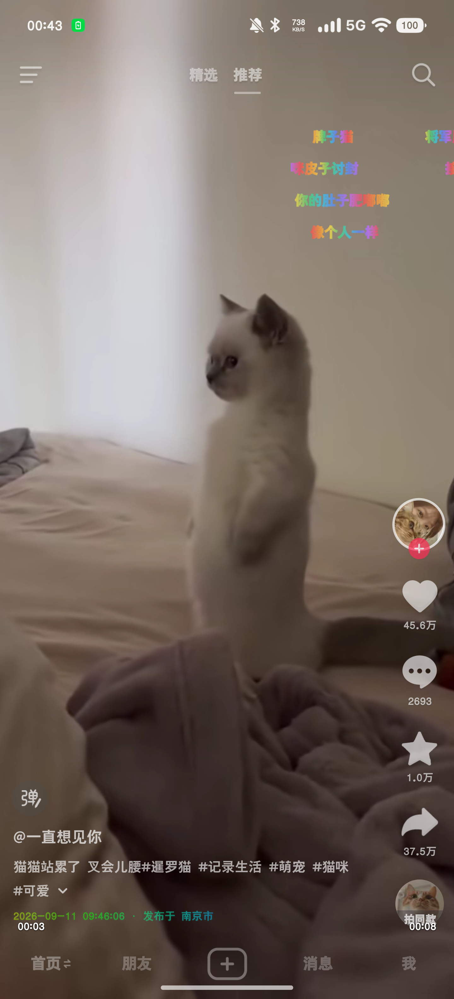

## 六类设置主页面 · 浅色

Doula `1.1.0-native-settings.21` · 抖音 `40.7.0 / 400701`

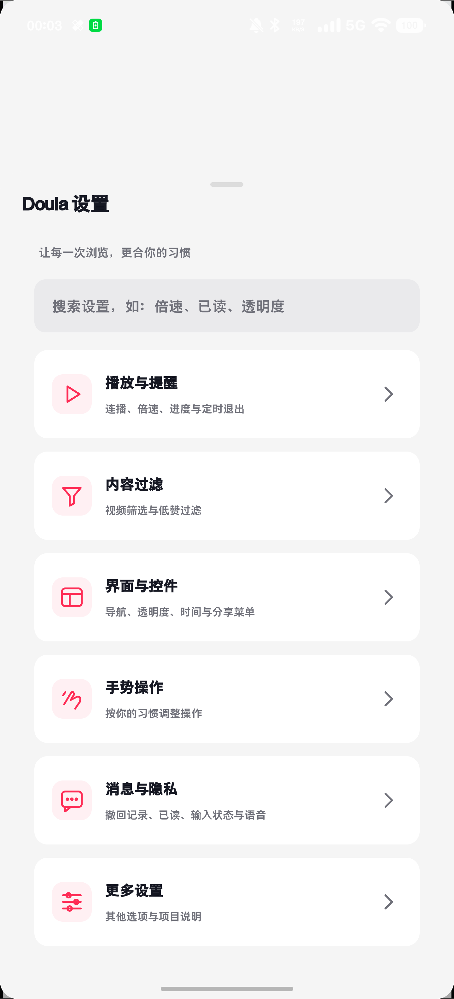

## 界面与控件展开 · 深色

Doula `1.1.0-unified-test.23` · 抖音 `40.7.0 / 400701`

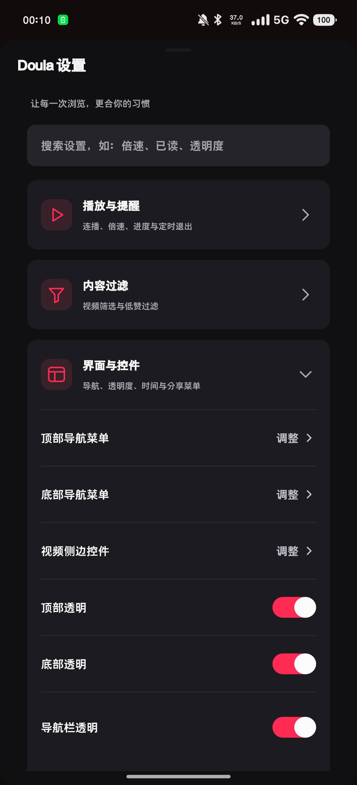

## 设置搜索与清空入口

Doula `1.1.0-unified-test.23` · 抖音 `40.7.0 / 400701`

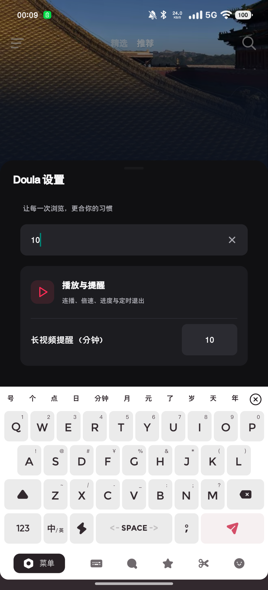

## 顶部标签隐藏列表

Doula `1.1.0-unified-test.23` · 抖音 `40.7.0 / 400701`

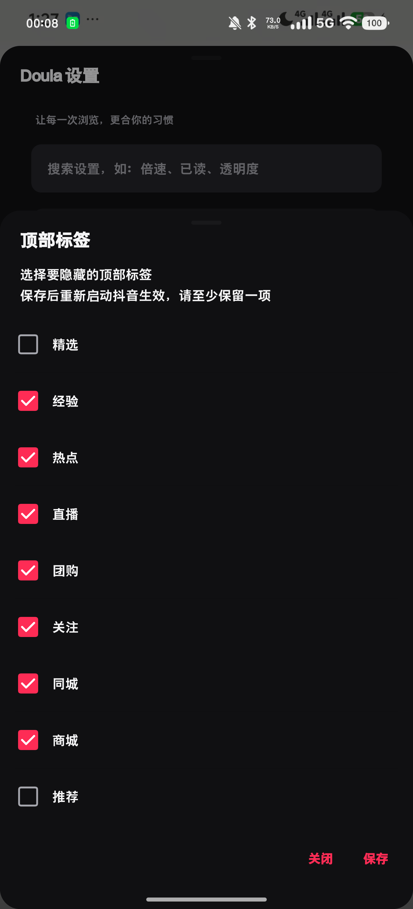

## 播放与暂停六项透明度

Doula `1.1.0-unified-test.23` · 抖音 `40.7.0 / 400701`

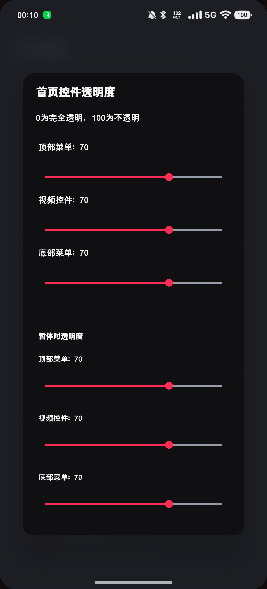

## 浅色界面、彩虹弹幕与导航高度入口

Doula `1.1.0-unified-test.23` · 抖音 `40.7.0 / 400701`

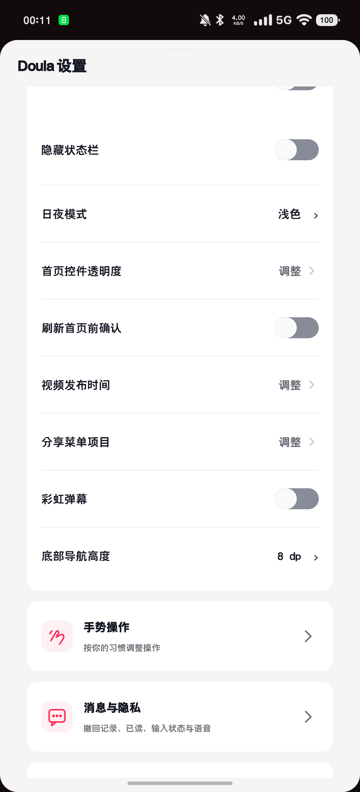

## 四区域双击与长按

Doula `1.1.0-unified-test.24` · 抖音 `40.7.0 / 400701`

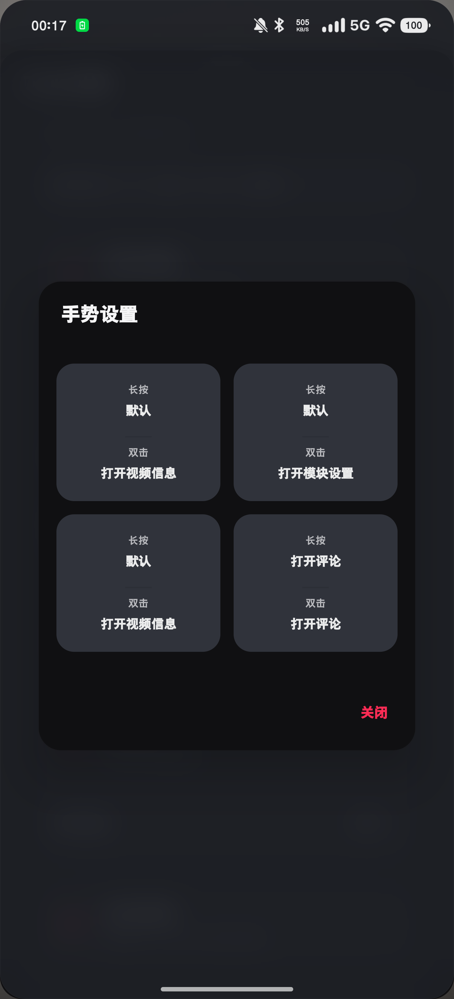

## 11 类视频过滤

Doula `1.1.0-unified-test.24` · 抖音 `40.7.0 / 400701`

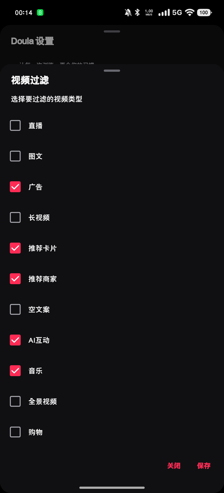

## 推荐流最低点赞数 · 浅色

Doula `1.1.0-unified-test.26` · 抖音 `40.7.0 / 400701`

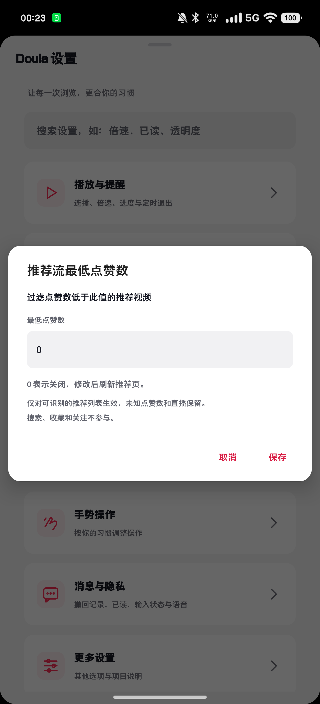

## 推荐流最低点赞数 · 深色

Doula `1.1.0-unified-test.26` · 抖音 `40.7.0 / 400701`

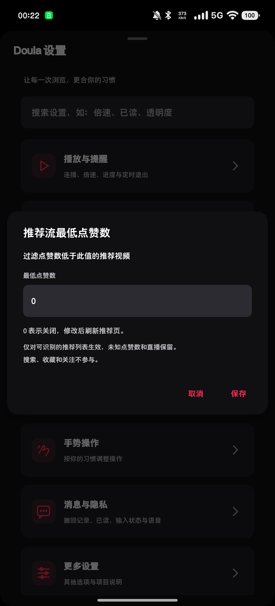

## 历史材料

[1.0.x 历史截图](GALLERY-1.0.x.md)仅用于版本对照，不作为40.7新UI展示。

[截图来源及哈希](screenshots/update-40.7/manifest.json) · [验证范围](VALIDATION.md)
