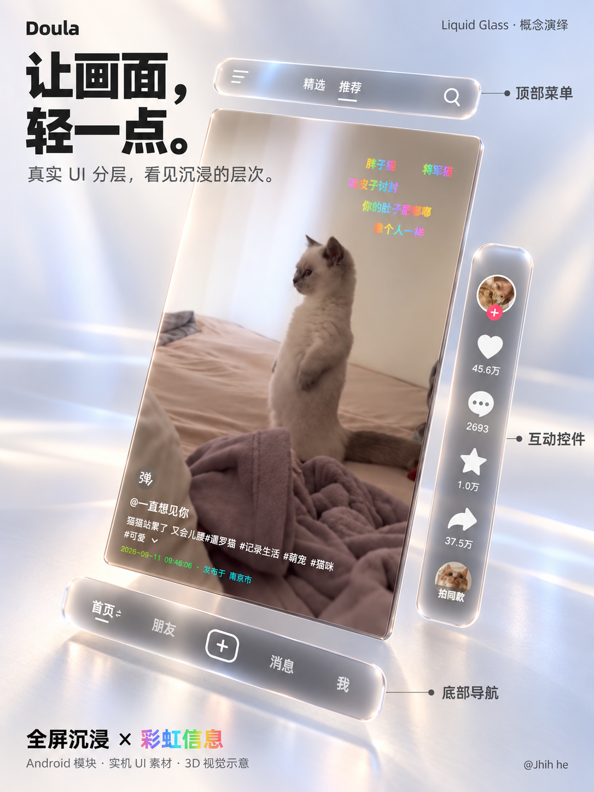
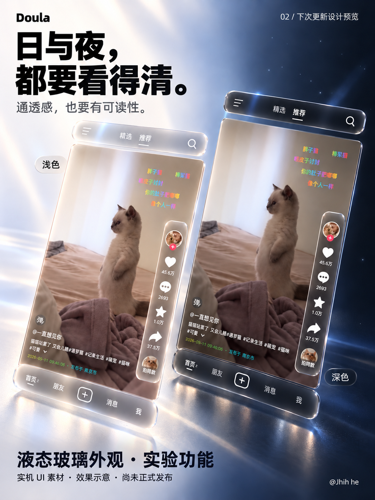
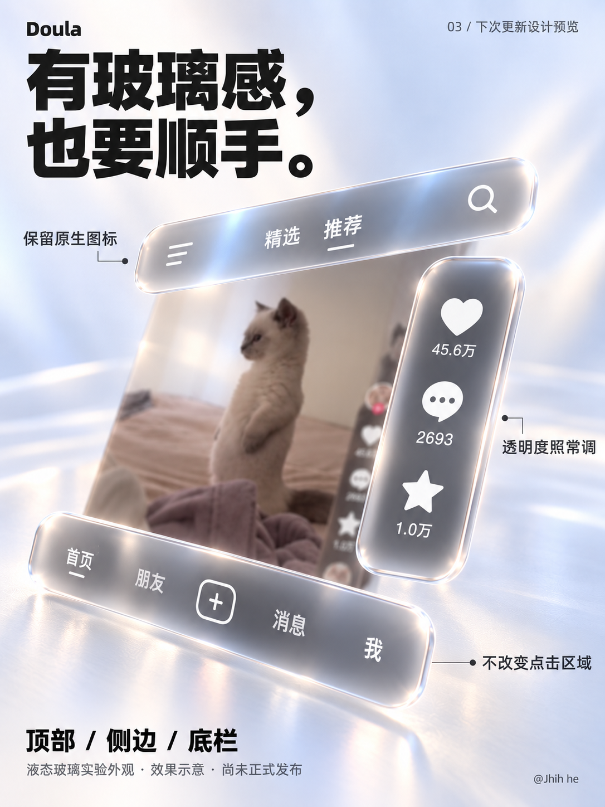
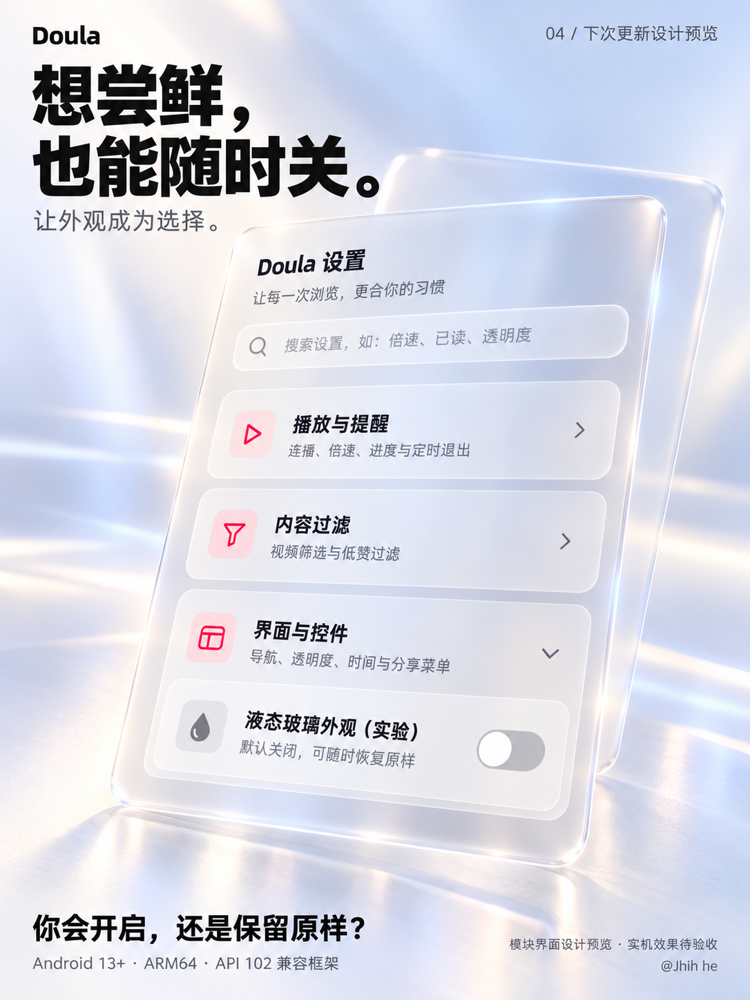

# Doula 液态玻璃 · 下次更新设计预览

维护者：@Jhih he。2026-10-16。

以下是基于抖音实机 UI 素材制作的 AI 辅助三维排版与材质演绎，**不是已发布版本的实机截图**。液态玻璃外观已进入本地候选，默认关闭，可关闭恢复原背景；当前未完成双版本实机验收，公开 preview.1 不包含这项外观。

Android 候选目前提供轻量染色与边缘高光，模块面板复用画面快照模糊；视频上的实时光学折射、实时背景模糊尚未实现。海报里的三维厚度、透镜及光学表现是目标视觉，应用不会把控件变成悬浮模型。

## 真实 UI 的三维分层

## 日夜外观与可读性

## 保留原生图标和操作

## 默认关闭的实验开关

## 使用与来源

全屏沉浸、彩虹文字弹幕、发布时间与可读取发布地继续保留；功能和可用版本以 [Releases](https://github.com/Xposed-Modules-Repo/io.github.jhihhe.doula/releases) 为准。要求 Android 13+、ARM64 与现代 Xposed API 102 兼容框架。视频素材为第三方公开内容，原创作者与本模块无关联。Apple Liquid Glass 仅为视觉参考，本模块没有使用 Apple 私有 API，也与 Apple 或抖音官方无隶属关系。

未经三维重排的原始界面见 [真机截图](GALLERY.md)；当前验证范围见 [VALIDATION.md](VALIDATION.md)。旧海报保留作历史材料，首页使用本套新图。
