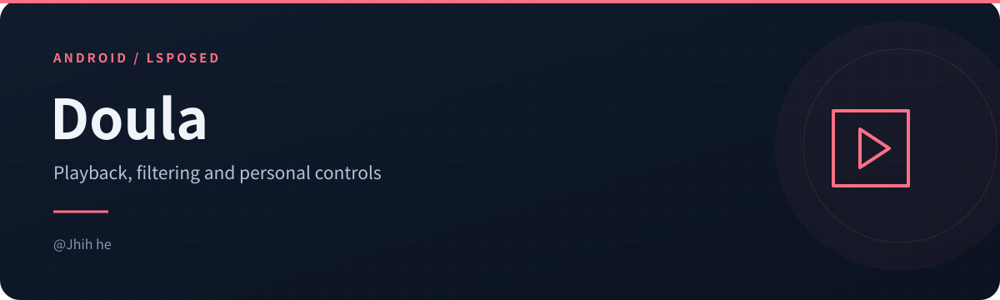
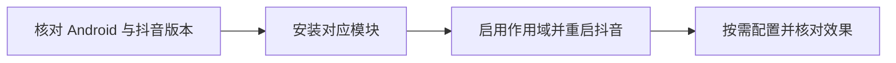
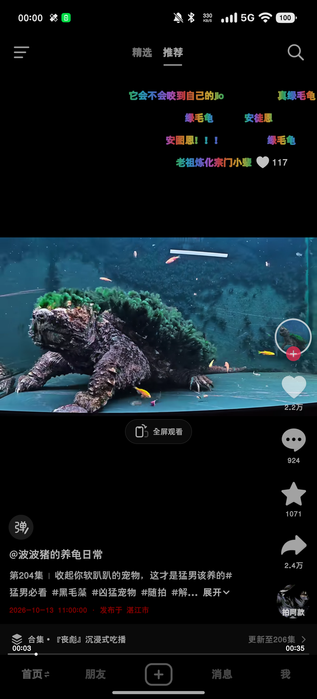

<!-- readme-visuals:header:start -->

  
  
  

<!-- readme-visuals:header:end -->

  
# Doula · 沉浸播放，让画面更出彩

Doula 是适用于抖音的 LSPosed 模块，提供沉浸播放、内容过滤、手势、消息和媒体工具。按自己的习惯调整界面与播放体验。

**全屏控件半透明沉浸播放 · 彩虹弹幕 · 发布时间与发布地**

@Jhih he · Android 13+ · ARM64 · 现代 Xposed API 102

[Telegram 交流群：@DOULA_LSPOSED](https://t.me/Doula_LSPosed)

[官方发行与下载](https://github.com/Xposed-Modules-Repo/io.github.jhihhe.doula/releases) · [完整功能](FEATURES.md) · [更新日志](CHANGELOG.md) · [真实截图](GALLERY.md) · [反馈教程](BUG-REPORT.md)

## 版本与下载

**Doula 1.1.5 正式版 · 2026111301 · 2026-11-13**

编译时间：2026-11-13 08:39:35（北京时间）。

本次加入抖音 41.1.0 适配、自动播快捷开关和个人主页底栏开关，精简侧栏隐藏列表，修复分享、图片保存和关注确认，调整发布时间彩虹及进度时间样式。与 1.1.4 的 12 组变化见 [更新日志](CHANGELOG.md)。

[下载 1.1.5 APK / ZIP](https://github.com/Xposed-Modules-Repo/io.github.jhihhe.doula/releases/tag/2026111301-1.1.5) · [Telegram 下载话题](https://t.me/Doula_LSPosed/4) · [全部版本](https://github.com/Xposed-Modules-Repo/io.github.jhihhe.doula/releases)

需要 Android 13+、ARM64、现代 Xposed API 102。覆盖安装后完整重启抖音。适配代码保留 40.6–41.1 路径；一台设备上的部分功能已有实测，其他机型、旧宿主及部分功能组合仍待回归，详见 [验证范围](VALIDATION.md)。

旧蓝奏链接仍是 **1.1.4 修正版**，本轮 1.1.5 请使用上面的 GitHub 或 Telegram 附件，不把旧链接当成新包。

## 项目速览

<table>
<tr>
<td width="33%"><strong>沉浸播放</strong>  分别调整顶底菜单与视频控件透明度。</td>
<td width="33%"><strong>内容与操作</strong>  内容过滤、四区域手势及媒体工具。</td>
<td width="33%"><strong>版本与验证</strong>  适配范围与实测边界以 VALIDATION.md 为准。</td>
</tr>
</table>

### 流程概览

<!-- readme-visuals:overview:end -->

## 重点体验：画面更沉浸，信息更清楚

### 全屏控件半透明沉浸播放

顶部菜单、视频控件、底部菜单的透明度分别调节，播放与暂停各有一套设置。**0–100 自由选择：半透明保留必要操作提示，完全透明让画面更干净，暂停时也可以恢复显示。** 状态栏与导航栏另有显示选项，视频保持原始画幅，不强行拉伸横屏内容。

透明不等于禁用点击，也不承诺所有页面和原生控件都隐藏。建议先选半透明，再按习惯微调。[透明度和手势真机界面](GALLERY.md)

### 液态玻璃实验外观

设置页面使用 70% 快照毛玻璃效果。实验玻璃开关默认关闭，用于控制其他已适配控件；关闭后恢复这些控件的原样。照片和视频长按菜单也调整了背景与明暗模式下的文字、图标和倍速显示。

### 彩虹弹幕

让文字弹幕呈现彩虹渐变，保留图片表情原样，不把普通菜单一起染色。**未经三维重排的40.7候选真实显示见下图**；已验证的Compose路径、关闭恢复白色及其他待测后端见[验证记录](VALIDATION.md)。

### 视频发布时间与发布地

分别选择显示时间、显示发布地，也可启用多彩显示。让内容发布信息更直观；**仅显示视频提供的可读取发布地，缺失时不猜测、不推算创作者实时位置**。这不是查看他人当前位置的工具。

真机截图同时展示半透明控件、彩虹弹幕与视频时间/发布地，来自40.7 / 1.1.0-dy40.6-40.7-api102-rc.3候选。视频与弹幕为第三方公开内容，创作者与本模块无关联。

## 设置更多，查找更直接

设置按六类整理：**播放与提醒、内容过滤、界面与控件、手势操作、消息与隐私、更多设置**。关键词搜索可以缩小选项范围，清空后恢复分类；保留原控件与配置绑定。

浅色与深色统一重绘卡片、输入框、红色开关、复选状态、单选列表和操作按钮。菜单隐藏、四区域手势、透明度及低赞输入窗口同步更新。

## 既有功能与改进

- **默认播放倍速**：跟随抖音，或选择 0.75 / 1 / 1.25 / 1.5 / 2 倍；固定值在新视频首帧应用，保留原生临时倍速。
- **推荐流最低点赞数**：0 表示关闭，仅处理可识别的推荐列表。未知点赞数、直播保留，搜索、收藏与关注不参与。
- **底部导航高度调节**：配合系统安全区域处理，改善底栏、前景控件和进度区域间距；更多机型和页面仍需继续核验。
- **彩虹弹幕**：增加开关与局部文字渐变适配。40.7 候选已见 Compose 文字渐变及关闭恢复白色；图片表情不染色，40.6 和其他后端未全部实测。
- **桌面缓存维护**：重新扫描 DEX、清除 Doula 缓存；完整退出并重启抖音后处理，保留抖音账号、聊天和草稿。

## 保留熟悉的操作，也修复实际问题

沉浸播放、顶/底菜单和视频控件隐藏、播放/暂停六项透明度、四区域双击和长按、11 类视频过滤、文案正则、时间与发布地、消息与评论、媒体工具等继续保留。

此前修复涉及 API 102 加载桥、配置初始化竞态、版本缓存、菜单全隐藏恢复、收藏隐藏、评论与拍摄手势、完成暂停和自动连播、原生进度时间生命周期、消息已读与输入状态接口、媒体保存和存储路径。各项实现与实测范围见 [更新日志](CHANGELOG.md) 和 [验证记录](VALIDATION.md)。

## 安装与使用

需要 Android 13 或更高版本、ARM64 设备，以及支持现代 Xposed API 102 的框架。适配路径包括官方抖音 40.6.0 / 400601、40.7.0 / 400701、40.8.0 / 400801、40.9.0 / 400901、41.0.0 和 41.1.0；不同版本的功能验证范围请查看 [验证记录](VALIDATION.md)。

1. 使用支持现代 Xposed API 102 的框架；环境要求 Android 13+ / ARM64。
2. 安装 Releases 中明确对应目标抖音版本的 APK。官方包名 `io.github.jhihhe.doula`，抖音目标包名 `com.ss.android.ugc.aweme`。
3. 在 LSPosed 启用 Doula 并勾选抖音作用域。
4. 强制停止抖音后重新打开，长按视频或照片，在弹出菜单中选择「Doula 设置」；也可使用已配置的模块手势入口。
5. 菜单勾选的是要隐藏的项目，保存后按提示重启。不要清除抖音数据来解决普通加载问题。
6. 无入口或不生效时，按 [反馈教程](BUG-REPORT.md) 提交具体版本、步骤与日志。桌面缓存维护不能修复框架不支持或作用域错误。

本轮适配路径针对 **40.6.0 / 400601**、**40.7.0 / 400701**、**40.8.0 / 400801** 与 **40.9.0 / 400901**；1.1.5 在 1.1.4 的 41.0.0 基础上新增 41.1.0 适配，部分功能已实测，其余功能及旧版回归仍在继续；不等于任意“最新版”都兼容。Android 11、抖音极速版、TikTok 及其他版本不在当前支持声明中。

## 截图、验证与反馈

[新 UI 完整截图集](GALLERY.md) · [新增与原有功能清单](FEATURES.md) · [验证范围](VALIDATION.md) · [宣传文案](MARKETING.md)

截图集中的 11 张截图均为历史候选真机原图，来自 rc.3 与 test.21 / .23 / .24 / .26 候选，确切版本见截图集。截图里的选项值不代表默认值，不表示 1.1.4 全部验收。旧图和历史说明保留在 [1.0.x 记录](README-1.0.x.md)。

[提交问题](https://github.com/jhihhe/Doula-Douyin-LSPosed/issues)。体验有帮助，欢迎收藏、留言并自愿支持维护；反馈请附具体版本和复现步骤。

Doula 当前界面、兼容层与发布维护者：**@Jhih he**。[版权与来源声明](NOTICES.md)。仓库用于文档、宣传图、真实截图与发行记录，不公开模块源码、原始输入 APK、私有日志或签名密钥。Doula 与抖音官方无隶属关系。
