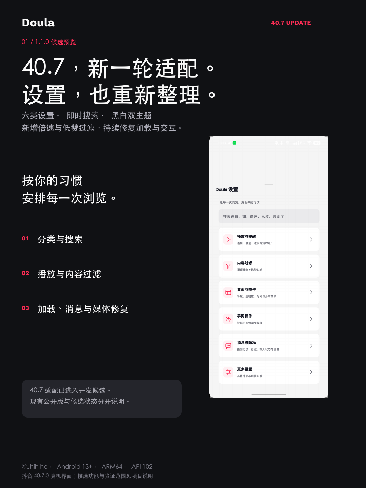
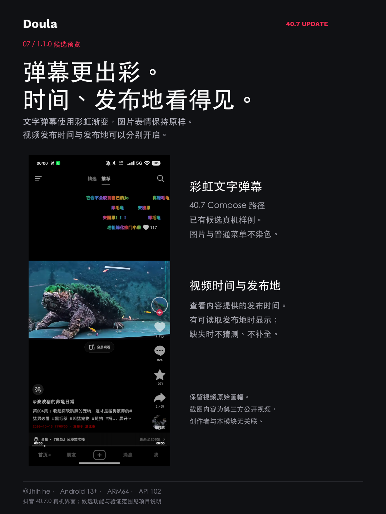
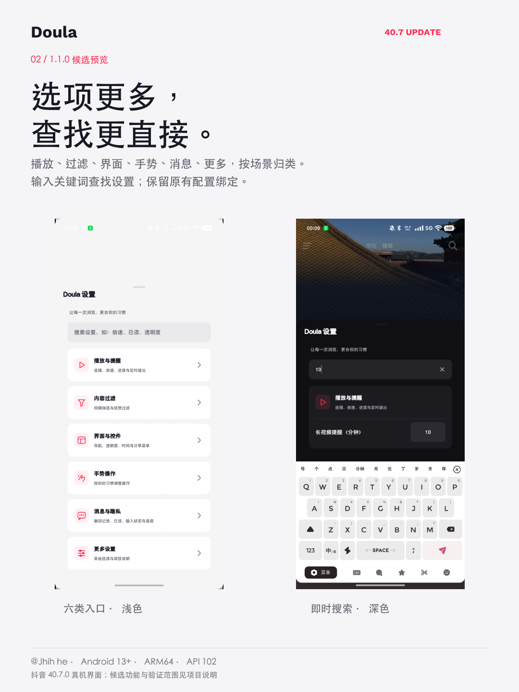
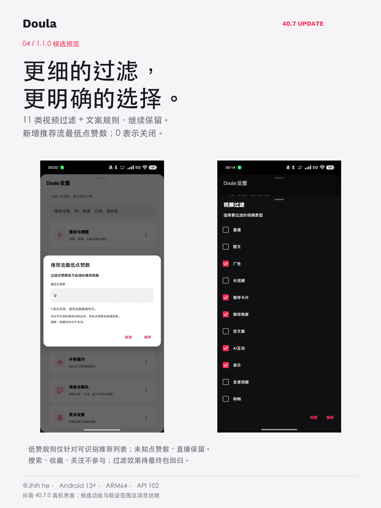
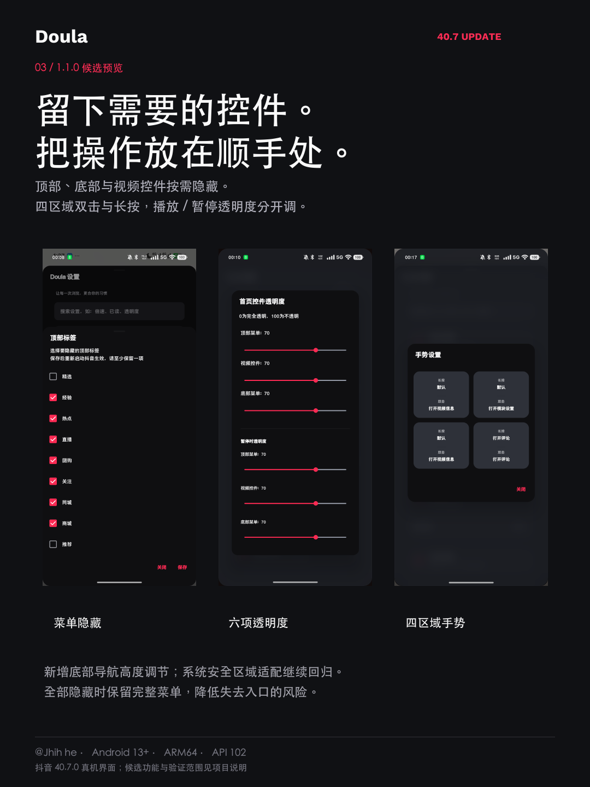
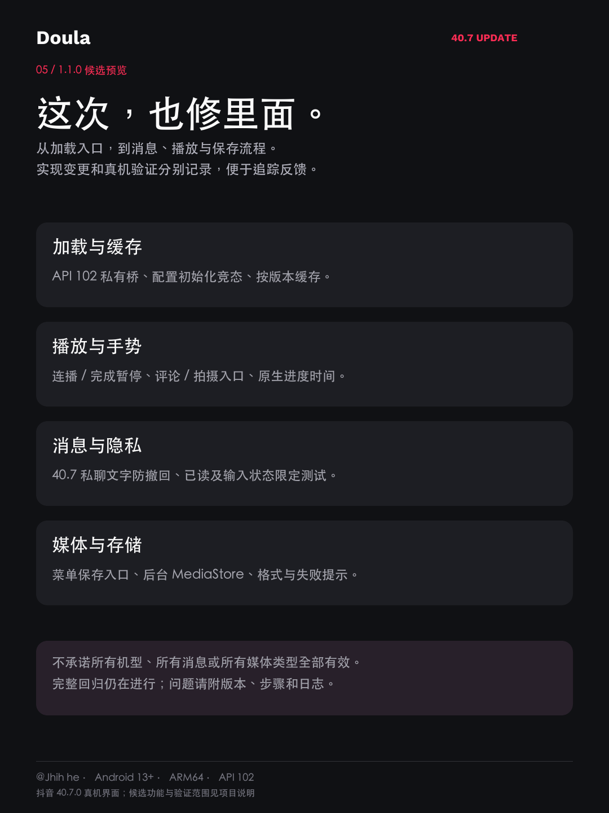
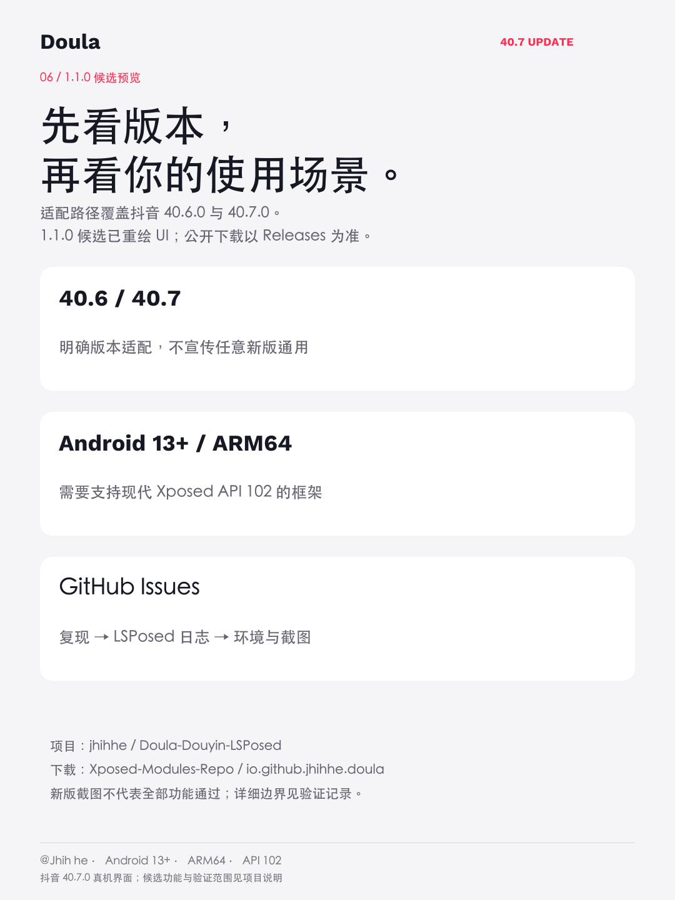

# Doula · 沉浸播放，让画面更出彩

抖音 40.6 / 40.7 · 让画面更沉浸，让弹幕与信息更清楚。

**全屏控件半透明沉浸播放 · 彩虹弹幕 · 发布时间与发布地**

@Jhih he · Android 13+ · ARM64 · 现代 Xposed API 102

[官方发行与下载](https://github.com/Xposed-Modules-Repo/io.github.jhihhe.doula/releases) · [完整功能](FEATURES.md) · [更新日志](CHANGELOG.md) · [真实截图](GALLERY.md) · [反馈教程](BUG-REPORT.md)

## 本轮更新状态

**40.7.0 适配和下列新功能已进入 1.1.0 开发候选，新 UI 已有真机截图。最终统一包的完整双版本回归仍在进行，尚未发布 1.1.0。**

| 版本 | 当前状态 |
| --- | --- |
| 1.1.0 候选 · 抖音 40.6.0 / 40.7.0 | 本轮功能、修复与新 UI 介绍对象；不同候选的限定验证见记录，不代表最终包全部通过。 |
| [1.0.2 正式版](https://github.com/Xposed-Modules-Repo/io.github.jhihhe.doula/releases/tag/2026100620-1.0.2-dy40.6.0-api102) | 已公开发行的 40.6.0 历史版本，不包含本页全部 1.1.0 新增内容。 |
| [1.0.2 测试版 preview.9](https://github.com/Xposed-Modules-Repo/io.github.jhihhe.doula/releases/tag/2026100621-1.0.2-dy40.6.0-api102-preview.9) | 历史测试通道保留，与同次正式版代码和功能一致，仅版本标识不同。 |

安装包和可用版本以 Releases 为准。宣传页更新不等于新 APK 已发布，请勿把旧包用于验证本轮新增功能。

## 重点体验：画面更沉浸，信息更清楚

### 全屏控件半透明沉浸播放

顶部菜单、视频控件、底部菜单的透明度分别调节，播放与暂停各有一套设置。**0–100 自由选择：半透明保留必要操作提示，完全透明让画面更干净，暂停时也可以恢复显示。** 状态栏与导航栏另有显示选项，视频保持原始画幅，不强行拉伸横屏内容。

透明不等于禁用点击，也不承诺所有页面和原生控件都隐藏。建议先选半透明，再按习惯微调。[透明度和手势真机界面](GALLERY.md)

### 彩虹弹幕

让文字弹幕呈现彩虹渐变，保留图片表情原样，不把普通菜单一起染色。**下图为40.7候选的真实显示**；已验证的Compose路径、关闭恢复白色及其他待测后端见[验证记录](VALIDATION.md)。

### 视频发布时间与发布地

分别选择显示时间、显示发布地，也可启用多彩显示。让内容发布信息更直观；**仅显示视频提供的可读取发布地，缺失时不猜测、不推算创作者实时位置**。这不是查看他人当前位置的工具。

真机截图同时展示半透明控件、彩虹弹幕与视频时间/发布地，来自40.7 / rainbow-test.20候选。视频与弹幕为第三方公开内容，创作者与本模块无关联。

## 设置更多，查找更直接

设置按六类整理：**播放与提醒、内容过滤、界面与控件、手势操作、消息与隐私、更多设置**。关键词搜索可以缩小选项范围，清空后恢复分类；保留原控件与配置绑定。

浅色与深色统一重绘卡片、输入框、红色开关、复选状态、单选列表和操作按钮。菜单隐藏、四区域手势、透明度及低赞输入窗口同步更新。

## 本轮新增与改进

- **默认播放倍速**：跟随抖音，或选择 0.75 / 1 / 1.25 / 1.5 / 2 倍；固定值在新视频首帧应用，保留原生临时倍速。
- **推荐流最低点赞数**：0 表示关闭，仅处理可识别的推荐列表。未知点赞数、直播保留，搜索、收藏与关注不参与。
- **底部导航高度调节**：配合系统安全区域处理，改善底栏、前景控件和进度区域间距；最终统一包仍需完整回归。
- **彩虹弹幕**：增加开关与局部文字渐变适配。40.7 候选已见 Compose 文字渐变及关闭恢复白色；图片表情不染色，40.6 和其他后端未全部实测。
- **桌面缓存维护**：重新扫描 DEX、清除 Doula 缓存；完整退出并重启抖音后处理，保留抖音账号、聊天和草稿。

## 保留熟悉的操作，也修复实际问题

沉浸播放、顶/底菜单和视频控件隐藏、播放/暂停六项透明度、四区域双击和长按、11 类视频过滤、文案正则、时间与发布地、消息与评论、媒体工具等继续保留。

本轮修复涉及 API 102 加载桥、配置初始化竞态、版本缓存、菜单全隐藏恢复、收藏隐藏、评论与拍摄手势、完成暂停和自动连播、原生进度时间生命周期、消息已读与输入状态接口、媒体保存和存储路径。各项实现与实测范围见 [更新日志](CHANGELOG.md) 和 [验证记录](VALIDATION.md)。

## 安装与使用

1. 使用支持现代 Xposed API 102 的框架；环境要求 Android 13+ / ARM64。
2. 安装 Releases 中明确对应目标抖音版本的 APK。官方包名 `io.github.jhihhe.doula`，抖音目标包名 `com.ss.android.ugc.aweme`。
3. 在 LSPosed 启用 Doula 并勾选抖音作用域，避免同时启用旧包名模块或修改同一区域的其他模块。
4. 强制停止抖音后重新打开，在首页左上角菜单处长按约一秒进入 Doula 设置；也可使用已配置的模块手势入口。
5. 菜单勾选的是要隐藏的项目，保存后按提示重启。不要清除抖音数据来解决普通加载问题。
6. 无入口或不生效时，按 [反馈教程](BUG-REPORT.md) 提交具体版本、步骤与日志。候选桌面缓存维护不能修复框架不支持或作用域错误。

本轮适配路径针对 **40.6.0 / 400601** 与 **40.7.0 / 400701**；不等于任意“最新版”都兼容。Android 11、抖音极速版、TikTok 及其他版本不在当前支持声明中。

## 截图、验证与反馈

[新 UI 完整截图集](GALLERY.md) · [新增与原有功能清单](FEATURES.md) · [验证范围](VALIDATION.md) · [宣传文案](MARKETING.md)

本轮 11 张截图均为真机原图，来自 rainbow-test.20 与 test.21 / .23 / .24 / .26 候选，确切版本见截图集。截图里的选项值不代表默认值；海报只排版文字和原图，不表示最终包全部验收。旧图和历史说明保留在 [1.0.x 记录](README-1.0.x.md)。

[提交问题](https://github.com/jhihhe/Doula-Douyin-LSPosed/issues)。体验有帮助，欢迎收藏、留言并自愿支持维护；反馈请附具体版本和复现步骤。

Doula 基于原“抖+”模块适配，保留上游及第三方版权、许可证和致谢。当前界面、兼容层与发布维护者：**@Jhih he**。新增低赞策略参考 dopee 的 MIT 许可 DouyinLowLikeFilter 语义后独立实现。仓库用于文档、宣传图、真实截图与发行记录，不公开模块源码、原始输入 APK、私有日志或签名密钥。Doula 与抖音官方无隶属关系。
